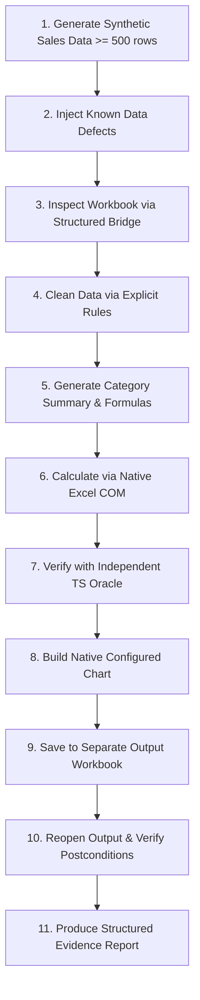

# ORBIT — Excel Specialist Agent: Technical Design & Implementation Plan
## Incremental, Evidence-Driven & Autonomous Architecture

> **Core Mandate:**
> Strictly **ZERO** predefined task-specific code, **ZERO** hardcoded task templates, **ZERO** task-specific macros, and **ZERO** static shortcut recipes.
> All functionality is built **incrementally and verified through evidence**.
> No premature full-roadmap scaffolding or placeholder modules. We start with a rigorously verified single vertical slice.

---

## 1. Architectural Principles & Reality Grounding

### 1.1 COM Automation: Operational Reality vs. Claims
Native COM automation is **not** inherently 100% reliable. In production Windows environments, COM automation faces:
* RPC Server Unavailable (`0x800706BA` / `0x80010105`) when Excel crashes or terminates unexpectedly.
* Modal Dialog Blocking (e.g., file repair prompts, external link warnings, privacy notices) that indefinitely freeze single-threaded COM calls.
* Zombie Process Leaks (`EXCEL.EXE` remaining active in background, holding file handles).
* Timing & State Desync (COM calls returning before Excel finishes background recalculation or disk flushing).

**Required Reliability Engineering:**
1. **Explicit Timeouts:** Every external bridge call executes under a strict subprocess timeout (e.g., 15s for data reads, 30s for complex calculations).
2. **Process Lifecycle & PID Tracking:** Capture the exact `ProcessId` of the spawned Excel instance at launch. On failure, timeout, or exit, execute guaranteed cleanup terminating the tracked PID.
3. **Deterministic RCW Cleanup:** Guarantee execution of `[System.Runtime.InteropServices.Marshal]::ReleaseComObject()` inside `finally` blocks for all Workbooks, Worksheets, and Application instances.
4. **Postcondition Verification:** Never assume a COM write succeeded because no exception was thrown; verify the postcondition by reading back the mutated range.

---

### 1.2 Execution Modality Matrix

We explicitly document and distinguish the three execution modalities. The system **never** claims GUI execution when a background library or COM bridge was used.

| Modality | When to Use | Capabilities | Inherent Limitations | Prerequisites |
| :--- | :--- | :--- | :--- | :--- |
| **A. Headless Workbook Library** *(e.g., exceljs / node xlsx)* | Static file creation, raw cell data ingestion, batch cleaning without Excel process | Ultra-fast, zero process overhead, reliable in headless servers | **Cannot calculate dynamic formulas**; cannot render or export native Excel charts; cannot evaluate complex calculation chains | Node.js runtime only |
| **B. Native Excel COM Bridge** | Formula calculation, native chart generation, pivot tables, format conversions | Full fidelity of Microsoft Excel's native calculation and rendering engine | Windows-only; single-threaded; vulnerable to modal blocks and process leaks; requires PID management | Installed Microsoft Excel on Windows |
| **C. Multimodal GUI Operator** *(UI-TARS Vision + Keystrokes)* | Interactive user workflows, ribbon features, dialog handling, visual auditing | Interacts exactly as a human user; operates visual UI controls | High latency; sensitive to focus loss and modal race conditions; requires visual grounding | Active Desktop Session + FastInputServer |

---

### 1.3 Formula Evaluation & Independent Oracles
* **Library Limitation:** Headless libraries like `openpyxl` or `exceljs` write formula strings into cell XML, but **do not evaluate them**. They rely on cached calculation values from previous Excel sessions.
* **Calculation Engine:** Only native Microsoft Excel evaluates the workbook dependency tree via `Application.CalculateFull()`.
* **Independent Ground-Truth Verification:** Formula results are **never** verified solely by reading back the formula string. An independent TypeScript mathematical oracle computes the expected values directly from raw data inputs and compares them against the calculated cell values.

---

### 1.4 Secure Structured Bridge Architecture
Concatenating arbitrary user input or dynamic LLM strings into executable PowerShell code creates command injection, quoting breakage, and syntax failures. 

Instead of arbitrary script execution, we implement a **Secure Structured Bridge**:
* **Fixed, Allowlisted Operations Only:**
  - `InspectWorkbook`: Retrieves sheet names, dimensions, used range, and active cells.
  - `ReadRange`: Reads a 2D array of raw values and formulas from an explicit range.
  - `WriteDataRange`: Writes a 2D array of values to an explicit target range.
  - `InsertFormulaRange`: Inserts formulas into a target range and triggers calculation.
  - `CreateSummaryAndChart`: Generates category summaries and binds a native chart object.
  - `SaveWorkbookCopy`: Atomically flushes and saves the workbook to an isolated path.
  - `CloseAndCleanup`: Releases COM objects and terminates the target Excel PID.
* **Structured JSON Payload:** All arguments (paths, ranges, 2D arrays, chart types) are passed via serialized JSON files or standard input, validated against strict schemas before execution.
* **Zero String Concatenation:** No PowerShell commands are dynamically constructed from raw input.

---

### 1.5 Safe Workbook & File Handling Protocol
1. **Path Normalization & Traversal Defense:** Validate that all file paths resolve strictly inside the authorized workspace or temporary test directory.
2. **Lock Detection & Shadow Copying:** Check for active lock files (`~$*.xlsx`). Never perform destructive writes on locked user workbooks. Always work on an isolated working copy or create timestamped backups (`.bak`) before mutation.
3. **Macro & Security Alert Suppression:**
   - Set `Application.DisplayAlerts = $false`
   - Set `Application.AskToUpdateLinks = $false`
   - Set `Application.AutomationSecurity = 3` (`msoAutomationSecurityForceDisable`) to prevent malicious macro execution and eliminate hanging modal prompts.
4. **Interrupted Operation Recovery:** In case of process interruption (SIGINT, timeout), an exit trap guarantees Excel termination, releases file locks, and preserves the uncorrupted original file.

---

### 1.6 Evidence-Based Formula Repair
* Formula errors (`#REF!`, `#VALUE!`, `#DIV/0!`, `#NAME?`) are diagnosed through precedent cell inspection and data schema analysis.
* **Disambiguation Rule:** The agent repairs formulas **only** when there is unambiguous evidence of the intended relationship (e.g., column headers `Quantity` and `UnitPrice` supporting `Total = Quantity * UnitPrice`).
* If requirements or cell references are ambiguous, the agent **must not invent or guess** formulas; it flags the ambiguity in its structured report.

---

## 2. Step 1: Technical Design of the Excel Specialist Slice

The implementation is located under `apps/ui-tars/src/main/specialists/excel/` without modifying or polluting the general UI-TARS agent core:

```
apps/ui-tars/src/main/specialists/excel/
├── index.ts                     # Public entrypoint for the Excel Specialist
├── types.ts                     # Strict TypeScript schemas for operations & outcomes
├── bridge/
│   ├── excelBridge.ps1          # Robust, fixed-operation PowerShell COM bridge
│   ├── processManager.ts        # Process lifecycle, timeout & PID cleanup manager
│   └── structuredBridge.ts      # Node.js wrapper invoking allowlisted operations
├── oracle/
│   ├── mathOracle.ts            # Independent calculation and aggregation oracle
│   └── validator.ts             # Semantic comparator for values, formulas, and charts
└── verticalSlice/
    ├── syntheticGenerator.ts    # 500+ row sales generator with deliberate defects
    ├── sliceRunner.ts           # End-to-end coordinator for the vertical slice
    └── sliceReport.ts           # Structured PASS/PARTIAL/FAIL evidence reporter
```

---

## 3. Step 2: The First Vertical Slice Specification

We implement and verify **one complete vertical slice** before expanding to any wider benchmarks:



### Detailed Slice Workflow:
1. **Synthetic Generation:** Generate $\ge 500$ rows of sales transactions (`OrderID`, `Date`, `Category`, `Region`, `Units`, `UnitPrice`, `Total`).
2. **Defect Injection with Known Expected Outcomes:**
   - Trailing/leading whitespace in categories (e.g., `"Electronics "` $\rightarrow$ `"Electronics"`).
   - Inconsistent casing (e.g., `"furniture"` $\rightarrow$ `"Furniture"`).
   - Missing/invalid `Total` values (e.g., blank, 0, or calculation mismatch).
   - Duplicate `OrderID` entries requiring deduplication.
3. **Inspection:** Use `InspectWorkbook` to retrieve schema, dimensions, and detect null/invalid values.
4. **Data Cleaning:** Normalize text, remove duplicates, and validate positive values.
5. **Aggregation & Formulas:** Create a summary table by `Category` computing `Total Sales` (`SUMIFS`) and `Average Units` (`AVERAGEIFS`).
6. **Execution & Calculation:** Insert formulas and execute full native recalculation via COM.
7. **Independent Oracle Verification:** `mathOracle.ts` independently parses the raw cleaned data, computes expected category totals, and verifies that COM calculation matches within floating-point tolerance ($\epsilon = 0.001$).
8. **Native Chart:** Create a Clustered Column chart bound to the category summary range with explicit title, category axis, and legend.
9. **Separate Output Save:** Save result to `sales_cleaned_summary.xlsx` without modifying the original input file.
10. **Reopen & Postcondition Audit:** Reopen the saved file and verify:
    - Row count and cleaned values.
    - Active formulas present (not overwritten with static values).
    - Summary table integrity.
    - Chart presence, series count, and category names.
    - Zero corruption of unrelated columns (`Region`, `Date`).
11. **Evidence Report:** Generate a structured JSON/Markdown report with status `PASS`, `PARTIAL`, or `FAIL`.

---

## 4. Step 3: Test and Improvement Protocol

* **Seeded Variations:** Test the slice with at least 5 different random seeds varying row counts (500 to 2,000), category names, and defect distributions.
* **Failure Analysis Loop:**
  1. Reproduce failure under a deterministic seed.
  2. Capture execution trace, COM exit code, and error output.
  3. Identify root cause (e.g., COM busy state, locale-specific formula naming like `SUMME` vs `SUM`, date format parsing).
  4. Implement the smallest general fix.
  5. Add regression test case to test suite.
  6. Re-run failed test and entire regression suite.
  7. Verify fix across all other seeds.
* **Separation of Concerns:** Agent source code is **never modified dynamically** during agent execution. Code changes are made exclusively in the engineering/development environment with regression testing.

---

## 5. Step 4: Existing Project Preservation & Isolation

* **Working Tree Protection:** Audit git status before making changes. All existing UI-TARS features, Electron main/renderer processes, and remote proxy integrations remain untouched.
* **Security & Keys:** No modification of API key storage, sandbox controls, or security policies.
* **No Paid Services:** The vertical slice and testing harness run completely offline using local Node.js and local Microsoft Excel COM automation. No external paid APIs.
* **Truth in Modality:** The reporter explicitly logs which operations used COM automation and which used Node.js headless processing.

---

## 6. Step 5: Evidence & Completion Criteria

The vertical slice is considered complete only when:
1. All created and modified files are documented.
2. The benchmark runner executes with exit code 0 across multiple seeds.
3. The independent math oracle confirms 100% value and formula accuracy.
4. Clean post-save verification confirms chart properties and data integrity.
5. The structured evidence report is generated and inspected.
6. Genuine Excel COM availability is verified and documented.
